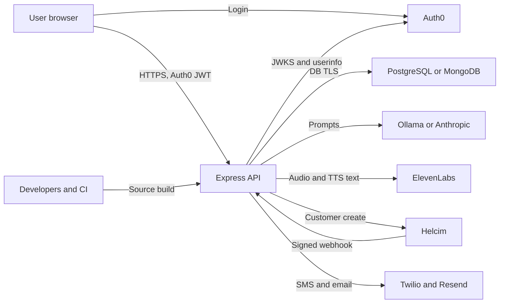

# Kindred-Asterling-AI-Coaching Threat Model

Revision: 2026-10-15, rewritten against the current `main` tree. Supersedes the earlier revision, which described retired components (custom session auth, Google Calendar, Stripe lookup) and gaps that are now closed.

## Executive summary

Kindred handles high-sensitivity mental-health chat, wellness and medication records, contact data, and payment entitlements. Identity is delegated to Auth0 (RS256 bearer JWTs, audience-checked, identity synced to `usersTable` with Auth0's `email_verified` flag). Paid access resolves by immutable user ID, Helcim webhooks are HMAC-verified with replay de-duplication and out-of-order guards, reminders omit medication names, and production CSP/HSTS are set by Helmet.

The main residual risks are operational rather than code-path defects: real operator/user data remains in Git history, one migration-only payment fallback matches by email without an email-verification check, the database TLS guarantees depend on deployment configuration, and there is no global AI/voice spend ceiling. Auth0 tenant settings (registration and email verification policy) sit outside this repository and are not verified here.

## Scope and assumptions

- In scope: `artifacts/api-server/**`, `artifacts/kindred-coach/**`, `lib/api-*`, `lib/db/**`, deployment manifests (`Dockerfile`, `.dockerignore`, `docs/*DEPLOYMENT*.md`), CI workflows, repository history for tracked data.
- Runtime scope: Express 5 API, React/Vite SPA, PostgreSQL (target, see cutover record) with MongoDB (current until cutover), Auth0, AI provider (`AI_PROVIDER`: `ollama` default or `anthropic`), ElevenLabs, Helcim, Twilio, Resend, and the in-process reminder scheduler.
- Retired and out of scope: custom password/session auth (`/api/auth/*`), Google Calendar connector (`docs/releases/calendar-sunset.md`), Stripe code (no references remain in `artifacts/api-server/src` or `lib`).
- Out of runtime scope: `node_modules`, build output, `artifacts/mockup-sandbox/**` unless deployed.
- Deployment assumption: public internet exposure (DigitalOcean App Platform target; Fly.io and Coolify are transitional). Findings note where priority rises.

Open questions that would change ranking:

- Whether `HELCIM_EMAIL_MIGRATION_FALLBACK` is `true` in any deployed environment (`.env.example` sets `false`; `SECRET_INVENTORY.md` marks it "verify/remove").
- Whether `SUBSCRIPTION_OWNER_EMAILS` is populated in production, and which accounts it names.
- Auth0 tenant settings: whether unverified emails can sign in, whether MFA is enforced, and whether brute-force protection is on.
- Whether the 51 Git commits that touched `attached_assets/` contain real personal data. Contents were not reviewed in this revision.
- Production database network allowlists and TLS mode for both MongoDB and PostgreSQL.

## System model

### Primary components

- React/Vite SPA: Auth0 SDK with `cacheLocation="memory"`, bearer token attached per request (`artifacts/kindred-coach/src/lib/auth.tsx`).
- Express API: Helmet and CSP, CORS allow-list, pino logging, Auth0 JWT middleware, general/write/chat rate limits, router-level `requireAuth` and `requireSubscription` (`artifacts/api-server/src/app.ts`, `middlewares/authMiddleware.ts`, `routes/index.ts`).
- Database: `lib/db/src/index.ts` selects Mongo (default) or Postgres (`DATABASE_PROVIDER=postgres`). Postgres pins a CA when `POSTGRES_CA_CERT` is set (`postgresConnectionConfig`); Mongo TLS is governed by `MONGODB_URI`.
- AI provider: `artifacts/api-server/src/lib/ai/` (Ollama and Anthropic providers), tool loop in `routes/chat.ts`, per-user tools in `lib/chatTools.ts`, crisis handling in `lib/crisisSafety.ts` and `config/crisisSupport.ts`.
- Voice: ElevenLabs STT/TTS through `routes/voice.ts` and `lib/elevenlabs.ts`.
- Payments: Helcim checkout, webhook, and customer lookup (`routes/subscription.ts`, `lib/helcimClient.ts`, `lib/subscriptionService.ts`).
- Messaging: Twilio SMS and Resend email (`lib/twilio.ts`, `lib/resend.ts`), driven by `lib/reminderScheduler.ts`.
- Reports: weekly PDF export (`routes/weeklyReport.ts`).

### Data flows and trust boundaries

- Browser -> API: Auth0 bearer JWT in `Authorization`, plus JSON (32 KB cap), raw audio (10 MB cap), and chat text (4,000 characters). No cookies are issued by the API, so cookie-based CSRF does not apply. CORS allows credentials only for allow-listed origins and localhost.
- API -> Auth0: JWT verification against the issuer JWKS. Profile loaded via userinfo, subject mismatches rejected, `@clients` tokens rejected (`middlewares/authMiddleware.ts`, `lib/auth0Profile.ts`).
- API -> Database: PII, chats, wellness and medication data, entitlement cache, and audit rows. Queries are scoped by `req.user.id`.
- API -> AI provider: user message, bounded history (24,000 characters), profile fields, and tool output (8,000 characters per call, four tool iterations, two attempts). The provider receives sensitive content by design.
- API -> ElevenLabs: audio clips (10 MB) and speech text (5,000 characters).
- Helcim -> API webhook: HMAC-SHA256 `v1` signature over `id.timestamp.body`, timing-safe comparison, five-minute window. Signed events are de-duplicated by `webhook-id` and out-of-order events are ignored by `providerEventAt`. Unsigned requests (missing headers) get a no-op 200; invalid signatures get 401.
- API -> Helcim: customer creation with the signed, non-PII `ka_` customer reference (HMAC over the user ID) and contact name set to the email.
- Scheduler -> Twilio/Resend: dose time, first name, and a link to the app. Medication names are not included in message text.
- Source/CI -> build: `.dockerignore` excludes `attached_assets`. Git history still contains the tracked attachments.

#### Diagram

## Assets and security objectives

| Asset                             | Why it matters                                                          | Security objective (C/I/A) |
| --------------------------------- | ----------------------------------------------------------------------- | -------------------------- |
| Chat and coaching history         | Intimate mental-health disclosures and AI context                       | C/I/A                      |
| Wellness and medication records   | Mood, symptoms, routines, medication use                                | C/I/A                      |
| Profile, email, phone, birthday   | Identifying and contact data; some fields enter the model prompt        | C/I                        |
| Auth0 access tokens               | Bearer credentials for the API; held in memory in the SPA               | C/I                        |
| Subscription entitlement          | Paid access and revenue integrity                                       | I/A                        |
| Provider and database credentials | Data access, messaging, AI/voice spend, service takeover                | C/I                        |
| Reminder destinations             | Phone numbers and emails that receive health-adjacent messages          | C/I                        |
| Weekly PDF exports                | Summaries of wellness and medication data, downloadable                 | C                          |
| Tracked repository attachments    | Real screenshots, chats, PDFs, and support data in Git history          | C/I                        |
| Service and provider quotas       | Chat, voice, database, SMS, and email availability and cost             | A                          |

## Attacker model

### Capabilities

- An internet user can reach the public SPA and API, attempt sign-up and sign-in through Auth0, and send bounded request bodies.
- An authenticated subscriber can submit adversarial chat and profile text, invoke AI tools, upload audio, request TTS, and generate PDF exports.
- An attacker may know a payer's email address, guess resource IDs, automate requests, or send forged or replayed webhooks.
- A repository collaborator, compromised developer account, CI runner, database credential holder, or network-positioned database attacker can reach higher-value assets.

### Non-capabilities

- No direct shell execution, arbitrary file upload or storage, server-side fetch of user-supplied URLs, or dynamic code evaluation was found in production routes.
- The model cannot choose a target user ID; tool execution uses the authenticated server-side user ID.
- Owner-only routes (`/api/admin/*` owner checks) require `emailVerified` as well as a listed owner email.
- The API issues no session cookies, so there is no server-side session store to steal or revoke.

## Entry points and attack surfaces

| Surface                          | How reached                    | Trust boundary               | Notes                                                                                                 | Evidence (repo path / symbol)                            |
| -------------------------------- | ------------------------------ | ---------------------------- | ----------------------------------------------------------------------------------------------------- | -------------------------------------------------------- |
| Sign-in and identity sync        | Auth0 SPA login, bearer JWT    | Client -> Auth0 -> API -> DB | RS256 and audience checked; `@clients` rejected; `emailVerifiedAt` persisted from Auth0               | `authMiddleware.ts`; `lib/auth0Identity.ts`              |
| Wellness, medication, profile    | Authenticated `/api/*`         | Client -> API -> DB          | `req.user.id` scoping; generated Zod schemas; 32 KB JSON cap                                          | `routes/*.ts`; `lib/api-zod/src/generated/api.ts`        |
| Chat agent and tools             | `/api/chat/send`               | Client -> API -> AI -> DB    | Chat limiter 20 per 5 min; daily quota (`DAILY_CHAT_LIMIT`, default 100, fails closed); crisis module  | `routes/chat.ts`; `lib/chatTools.ts`; `lib/dailyQuota.ts` |
| Voice API                        | `/api/voice/*`                 | Client -> API -> ElevenLabs  | 10 MB STT, 5,000-character TTS, generic write limiter only (no daily quota)                           | `routes/voice.ts`; `lib/elevenlabs.ts`                   |
| Payment webhook                  | `/api/payment/webhook`         | Helcim/Internet -> API -> DB | HMAC `v1`, timing-safe, 5-minute window, `processed_webhooks` ledger, `providerEventAt` ordering     | `routes/subscription.ts`; `lib/helcimClient.ts`          |
| Checkout                         | `/api/subscription/checkout`   | Client -> API -> Helcim      | Signed customer reference; DB lease prevents double-create                                            | `routes/subscription.ts`; `lib/helcimClient.ts`          |
| Entitlement resolution           | Global gate and status         | API -> DB                    | Owner IDs; owner emails only when verified; beta grants by user ID; Helcim cache with 5-minute TTL    | `lib/subscriptionService.ts`; `middlewares/requireSubscription.ts` |
| Reminder scheduler               | Internal, every minute         | DB -> Twilio/Resend          | Reads all enabled users; message text excludes medication names; deliveries de-duplicated             | `lib/reminderScheduler.ts`; `lib/twilio.ts`; `lib/resend.ts` |
| Weekly PDF export                | `/api/weekly-report/pdf`       | Client -> API -> DB          | User-scoped; `Cache-Control: no-store` applied by router-level middleware; `Content-Disposition: attachment` | `routes/weeklyReport.ts`; `routes/index.ts`         |
| Health and root                  | `/api/healthz`, `/api`         | Internet -> API              | Mounted before auth; no sensitive data                                                                | `routes/health.ts`; `app.ts`                             |
| Repository and CI                | Git clone, PR, build           | Developer/CI -> artifacts    | Working tree has no tracked attachments; history does; active workflow actions are SHA-pinned         | `.github/workflows/**`; `.dockerignore`                  |

## Top abuse paths

1. Use a payer's email to get paid access: attacker signs up with a known payer address -> Helcim fallback matching by email is enabled (`HELCIM_EMAIL_MIGRATION_FALLBACK=true`) -> the webhook binds the payer's customer to the attacker's account -> attacker reaches paid routes. Blocked when the flag is off, and the webhook path requires a signed reference or a single email match.
2. Replay or reorder a payment event: attacker captures a valid signed webhook -> replay is rejected by the `webhook-id` ledger, and older events are skipped by `providerEventAt` -> entitlement stays consistent. Residual: concurrent identical deliveries rely on transactional conflict handling; not load-tested.
3. Read stored data from the database: attacker gets database access or intercepts an unverified database connection -> reads chats and wellness records -> discloses them. Postgres with `POSTGRES_CA_CERT` verifies the server certificate; Mongo depends on the URI's TLS settings.
4. Extract private data from source access: compromised developer or CI account -> clones the private repository -> reads historical attachments -> real operator and user data leaves the controlled environment.
5. Abuse accounts after deployment: attacker mass-registers or stuffs credentials at Auth0 -> API rate limits are per IP or user, so distributed attempts reach Auth0 -> accounts and user records multiply. Auth0 tenant policy controls this, not the API.
6. Manipulate coaching context: authenticated user stores prompt-like profile or chat text -> model receives it with tool results -> unsafe or redirected coaching output. Cross-user tool access remains blocked by server-side user IDs.
7. Learn medication context: a third party sees a reminder on a shared phone or lock screen -> message shows dose time and first name, no medication names -> low-sensitivity disclosure.
8. Consume AI or voice budget: paid account repeatedly calls TTS or STT -> voice has no daily quota and no global ceiling exists -> provider spend rises.

## Threat model table

| Threat ID | Threat source                                              | Prerequisites                                                               | Threat action                                                                                | Impact                                                   | Impacted assets                       | Existing controls (evidence)                                                                                                                       | Gaps                                                                                                                                                                                    | Recommended mitigations                                                                                                                                                 | Detection ideas                                                                                       | Likelihood                                  | Impact severity | Priority |
| --------- | ---------------------------------------------------------- | --------------------------------------------------------------------------- | -------------------------------------------------------------------------------------------- | -------------------------------------------------------- | ------------------------------------- | -------------------------------------------------------------------------------------------------------------------------------------------------- | --------------------------------------------------------------------------------------------------------------------------------------------------------------------------------------- | ----------------------------------------------------------------------------------------------------------------------------------------------------------------------- | ----------------------------------------------------------------------------------------------------- | ------------------------------------------- | --------------- | -------- |
| TM-001    | Registrant with a known payer email                                        | `HELCIM_EMAIL_MIGRATION_FALLBACK=true` in a deployed environment                             | Sign up with a payer's email; webhook matches the email and links the payer's customer to them | Unauthorized paid access; payer's entitlement misbound    | Entitlement, revenue                  | Fallback is off by default (`.env.example`); requires a unique case-insensitive email match; signed customer reference preferred (`subscription.ts`) | Email fallback does not require `emailVerified`; `SUBSCRIPTION_OWNER_EMAILS` grants owner access to any verified account with that email (not a flag-gated path)                  | Confirm the flag is unset in every environment and remove the code path after migration; require `emailVerified` in the fallback; retire the owner-email bypass for owner IDs | Audit rows `helcim_*` with `customerEmail` match; alert on owner-email grants                         | Low when flag is off; high when on          | High            | high     |
| TM-002    | Attacker with a copy of the Git history                                    | Read access to the private repository or a fork                                             | Recover historical `attached_assets/` files                                                  | Disclosure of chats, screenshots, support records, PII   | Repository history, PII               | Working tree excludes `attached_assets` (zero tracked files at HEAD); `.dockerignore` excludes it                                                  | 51 commits touch `attached_assets/`; contents not reviewed here; history is not rewritten                                                                                               | Confirm contents; rewrite history with a documented tool and force-push policy; rotate any exposed credentials found; add pre-commit and CI PII and secret scanning | Audit clone and download events; alert on visibility changes                                          | Medium                                      | High            | high     |
| TM-003    | DB or network attacker with production DB access                           | Unverified TLS or network exposure to the database                                          | Read chat, wellness, and entitlement records in transit or at the server                    | Mass disclosure of mental-health data                    | All user data                         | Postgres CA pinning when `POSTGRES_CA_CERT` is set (`lib/db/src/postgresDb.ts`); Mongo credentials scoped to one database                       | Postgres does not require the CA when unset; Mongo TLS is configured only through `MONGODB_URI`, with no code-level enforcement; allowlists unverified                                   | Require `POSTGRES_CA_CERT` and `sslmode=verify-full` in production startup checks; require `tls=true` for Mongo URIs during cutover; restrict DB allowlists to app hosts      | Monitor failed TLS handshakes and connections from unexpected IPs                                    | Low with private network; medium if exposed | High            | medium   |
| TM-004    | Internet attacker against sign-in                                          | Auth0 tenant allows unlimited attempts or unverified sign-ups                               | Credential stuffing, mass account creation, or account preemption                           | Account takeover, DB growth, support load                | Accounts, user data, availability     | Auth0 owns sign-in; API rate limits by user or IP (`rateLimiter.ts`); `trust proxy` hop count configurable (`app.ts`)                             | Brute-force, MFA, breached-password, and email-verification policy live in Auth0 and are not verifiable from this repo; API rate limits do not cover Auth0 traffic                          | Verify Auth0 tenant settings (brute-force protection, MFA, email verification required before sign-in); document the settings in the cutover record                      | Auth0 tenant logs; alert on sign-up bursts and failed-login spikes                                    | Medium (tenant-dependent)                   | High            | medium   |
| TM-005    | Payment event attacker, provider fault, or operator error                  | Helcim enabled; checkout in use                                                             | Replay, reorder, or duplicate events to leave entitlement stale or wrong                     | Unauthorized access or wrongful denial                   | Entitlement, revenue                  | HMAC `v1` with timing-safe compare; five-minute window; `processed_webhooks` ledger (read-before-insert, added in this session); `providerEventAt` ordering; audit rows (`subscription.ts`, `helcimClient.ts`) | Concurrent identical deliveries untested under load; signed-but-unknown events return 500 and rely on provider retries                                                               | Add a concurrency test for duplicate `webhook-id`; return 2xx for known no-op events; alert on provider retry storms                                                  | Audit every event with ID, type, customer binding, old and new status, and outcome; alert on stale active rows | Medium when Helcim is enabled               | High            | medium   |
| TM-006    | Authenticated user and untrusted model output                              | Subscriber can control chat and profile text                                                | Prompt injection, unsafe coaching, or excess sensitive context sent to the provider          | Privacy harm, misleading health guidance, user safety    | Chat, profile, wellness data          | Per-user tool scoping; field, history, output, and iteration caps; crisis module and unit tests (`crisisSafety.test.ts`); no-diagnosis instruction | Profile text is concatenated into the system prompt without delimiters; no output-safety regression suite beyond crisis unit tests; provider retention terms not verified in repo         | Delimit profile fields; minimize tool data; add crisis and output-safety regression tests; document provider retention and DPA terms                                 | Log tool names and sizes without content; sample safety classifications; alert on tool-loop limits   | Medium                                      | High            | medium   |
| TM-007    | Shared device, stale destination, or messaging provider                    | Reminders enabled with a phone or email                                                     | Reminder text or first name seen by an unintended person                                     | Low-sensitivity disclosure; dose timing can be inferred  | Reminder destinations, schedule data  | Medication names excluded from message text (`reminderScheduler.ts`); delivery de-duplication; request timeouts                                    | Phone and email destinations are not verified before use (no confirmation step found); dose times and first names appear on lock screens                                             | Add destination verification before enabling channels; offer a generic-text setting; re-confirm destinations periodically                                              | Track destination changes and delivery failures; notify on channel changes                            | Medium                                      | Medium          | low      |
| TM-008    | Authenticated subscriber                                                   | Valid paid account                                                                          | Repeated chat, STT, or TTS calls within rolling limits                                       | Provider cost and degraded availability                  | AI and voice quotas, availability     | Chat limiter 20 per 5 min; per-user daily chat quota (fails closed); TTS 5,000 characters; STT 10 MB; provider call timeouts                       | No daily quota for voice; no global daily spend ceiling; no concurrency cap or circuit breaker across users                                                                              | Add per-user daily voice quota; add a global daily token and audio budget with alerts; concurrency caps; emergency feature flags                                        | Export provider usage and cost per user and endpoint; alert on spend spikes and 429/5xx rates          | Medium after deployment                     | Medium          | medium   |
| TM-009    | Cross-site attacker or injected frontend content                           | Victim visits an attacker page or XSS is introduced                                         | Frame the app, inject script, or use stolen tokens                                           | UI redress, data theft from memory or DOM                | Access tokens, record integrity       | Helmet with strict CSP (`scriptSrc 'self'`, no inline scripts), `frame-ancestors 'none'`, HSTS one year, `objectSrc 'none'` (`securityHeaders.ts`); tokens in memory only; no API cookies | `style-src` allows `'unsafe-inline'`; CORS credentials for allow-listed origins only; no CSP reporting endpoint                                                                           | Add a CSP report-uri or report-to endpoint; remove `'unsafe-inline'` styles when feasible                                                                               | CSP violation reports; alert on rejected origins                                                      | Low                                         | Medium          | low      |
| TM-010    | Supply-chain attacker or vulnerable dependency                             | Build or install step, or reachable vulnerable library                                      | Compromise build dependencies or exploit a library                                           | Build integrity loss; availability                        | Build artifacts, credentials          | `pnpm audit --prod` reports no known vulnerabilities (run 2026-10-15); active GitHub actions pinned to SHAs (one commented-out reference); Snyk, CodeQL, and Codacy workflows | Single-maintainer dependency risk not assessed; no SBOM or image scan in CI verified                                                                                                  | Produce an SBOM; scan the container image in CI; keep the audit gate in CI                                                                                              | Fail CI on production advisories; alert on lockfile and workflow changes                             | Low                                         | Medium          | low      |
| TM-011    | Export recipient or shared-device user                                     | Weekly PDF exported to a shared device or sent onward                                       | Obtain a PDF summary of wellness and medication data                                         | Disclosure of summarized health data                     | Wellness and medication summary       | User-scoped query; `no-store` on all router responses; `Content-Disposition: attachment`                                                              | No watermark, expiry, or export-event audit; PDF stays on the device after download                                                                                                     | Log export events (no content); consider a confirmation step for medication sections                                                                                   | Count exports per user per day; alert on bursts                                                       | Low                                         | Medium          | low      |

## Criticality calibration

- Critical: pre-auth remote code execution; unauthenticated bulk extraction of chat or medication data; a payment or auth bypass that also grants cross-user data access.
- High: verified unauthorized paid access through email misbinding (TM-001); public release of historical real-data attachments (TM-002); bulk database read (TM-003) if exposed.
- Medium: credential stuffing against accounts (TM-004); stale or unauditable payment state (TM-005); prompt injection affecting the requesting user (TM-006); sustained AI and voice cost abuse (TM-008).
- Low: reminder metadata disclosure (TM-007); dependency and CSP hardening items (TM-009, TM-010); PDF export exposure on a shared device (TM-011).

Ranking changes before public launch: TM-001 and TM-002 must be resolved or explicitly accepted. TM-003 and TM-004 depend on deployment and Auth0 configuration that must be verified in production. TM-008 should have a spend ceiling before wider beta.

## Focus paths for security review

| Path                                                     | Why it matters                                                                       | Related Threat IDs     |
| -------------------------------------------------------- | ------------------------------------------------------------------------------------ | ---------------------- |
| `artifacts/api-server/src/routes/subscription.ts`        | Webhook verification, ledger, email fallback, checkout                               | TM-001, TM-005         |
| `artifacts/api-server/src/lib/subscriptionService.ts`    | Owner, beta, and Helcim entitlement decisions; owner-email bypass                    | TM-001, TM-005         |
| `artifacts/api-server/src/lib/helcimClient.ts`           | Signature verification, customer reference, email lookup                             | TM-001, TM-005         |
| `artifacts/api-server/src/middlewares/authMiddleware.ts` | Auth0 JWT verification, identity sync, error classification                          | TM-004                 |
| `artifacts/api-server/src/lib/auth0Identity.ts`          | Identity linking and `emailVerifiedAt` persistence                                   | TM-001, TM-004         |
| `artifacts/api-server/src/middlewares/rateLimiter.ts`    | General, write, and chat limits; per-IP keying                                       | TM-004, TM-008         |
| `artifacts/api-server/src/app.ts`                        | Proxy trust, CORS, parsers, Helmet, middleware order                                 | TM-004, TM-009         |
| `artifacts/api-server/src/middlewares/securityHeaders.ts` | CSP, HSTS, framing policy                                                           | TM-009                 |
| `lib/db/src/postgresDb.ts`                               | CA pinning and TLS parameter handling (`postgresConnectionConfig`)                   | TM-003                 |
| `lib/db/src/mongoDb.ts`                                  | Mongo connection options and transactions                                            | TM-003, TM-005         |
| `artifacts/api-server/src/routes/chat.ts`                | Prompt construction, tool loop, caps, crisis handling                                | TM-006, TM-008         |
| `artifacts/api-server/src/lib/chatTools.ts`              | Server-side user scoping of tools                                                    | TM-006                 |
| `artifacts/api-server/src/lib/crisisSafety.ts`           | Crisis detection and response                                                        | TM-006                 |
| `artifacts/api-server/src/lib/dailyQuota.ts`             | Per-user daily chat quota (fail closed)                                              | TM-008                 |
| `artifacts/api-server/src/routes/voice.ts`               | Large binary input and billable provider calls                                       | TM-008                 |
| `artifacts/api-server/src/lib/reminderScheduler.ts`      | Cross-user batch processing and message content                                      | TM-007                 |
| `artifacts/api-server/src/lib/twilio.ts`                 | SMS destination handling and provider errors                                         | TM-007                 |
| `artifacts/api-server/src/routes/weeklyReport.ts`        | PDF export content and headers                                                       | TM-011                 |
| `attached_assets/**` (git history)                       | Historical real-data files                                                           | TM-002                 |
| `.dockerignore` and `Dockerfile`                         | Build-context exclusions                                                             | TM-002, TM-010         |
| `.github/workflows/**`                                   | CI permissions, action pinning, SAST                                                 | TM-010                 |

## Quality check

- [x] Route groups, scheduler, PDF export, and CI were checked against source for the claims in this document; retired components were removed from scope. Individual route handlers outside the listed surfaces were not line-audited.
- [x] Each claim changed from the prior revision was verified in the source at the time of writing (file presence, constants, headers, and env flags).
- [x] Priorities reflect current controls, and the old incorrect or retired references were removed.
- [x] Verification run in this session: `pnpm run typecheck:libs` and `tsc -p tsconfig.json --noEmit` for `@workspace/api-server` (0 errors); full API suite `pnpm --filter @workspace/db run test:api` (43 files, 419 tests) after the webhook fix; `pnpm audit --prod` (no known vulnerabilities).
- [ ] Not verified from the repository: Auth0 tenant settings, production environment variables (including `HELCIM_EMAIL_MIGRATION_FALLBACK`, `SUBSCRIPTION_OWNER_EMAILS`, `POSTGRES_CA_CERT`), database network allowlists, Helcim live behavior, and provider retention terms.
- [ ] Contents of the historical `attached_assets/` commits were not reviewed.
- [x] No secret values were printed or recorded in this document.
